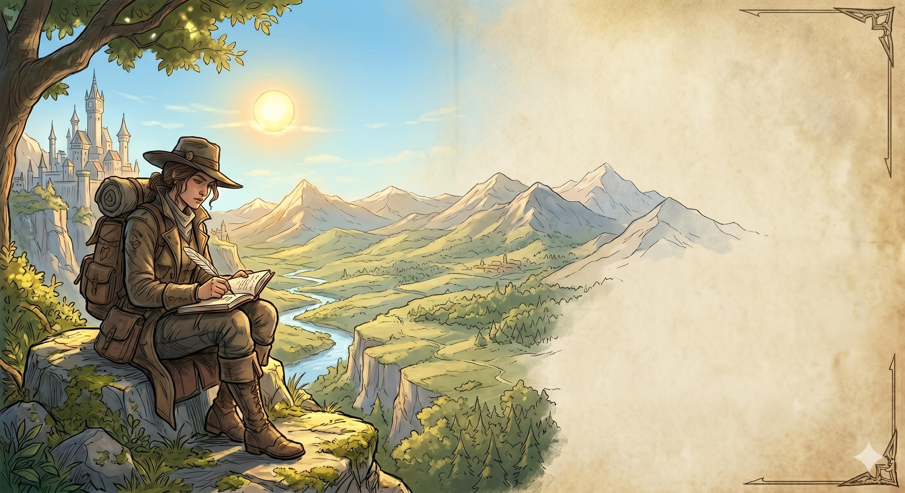
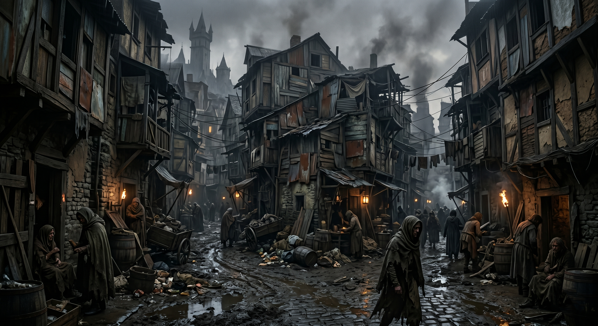
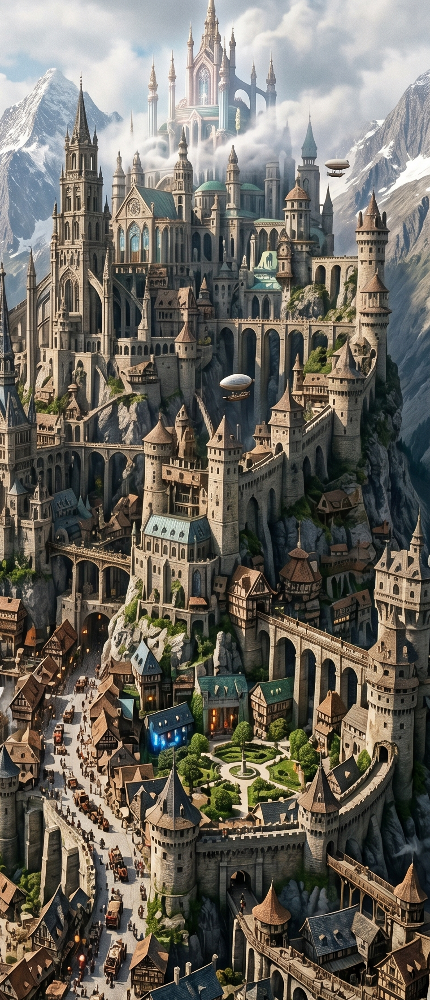
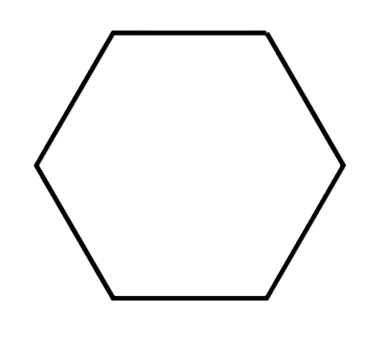

```metadata
title: Walking City
description: 'A mindfulness solo worldbuilding RPG: build a fantasy city one real-world stop at a time.'
tags: [solo, rpg, worldbuilding, mindfulness]
systems: []
renderer: V3
theme: 5ePHB
```

```css
/* A4 Page Size */
.page {
	width  : 210mm;
	height : 296.8mm;
}

```

{{frontCover}}

{{logo }}

# The Walking City
## Architects Field Guide
___

{{banner,font-size:2.5em Worldbuilding Solo RPG}}

{{footnote
  A Solo City Building RPG, Based in the Real World
}}

{position:absolute,bottom:0,left:0,height:100%}


\page

{{insideCover}}
{{imageMaskCenter9,--offsetX:0%,--offsetY:0%,--rotation:0
  {height:70%}
}}
<!-- Use --offsetX to shift the mask left or right (can use cm instead of %)
     Use --offsetY to shift the mask up or down
     Use --rotation to set rotation angle in degrees. -->
{{homebreweryCredits,position:absolute,bottom:60px,left:0px
Published By

 {width:60px,mix-blend-mode:multiply}

Dragons Talon  
}}

{{homebreweryCredits,position:absolute,bottom:180px,left:0px
Made With

{{homebreweryIcon}}

The Homebrewery  
[Homebrewery.Naturalcrit.com](https://homebrewery.naturalcrit.com)
}}


\page

{{imageMaskEdge7,--offset:6%,--rotation:90
  {height:100%}
}}
<!-- Use --offset to shift the mask away from page center (can use cm instead of %)
     Use --rotation to set rotation angle in degrees. -->


\column
{{toc
# Contents

- ### [{{ Welcome to The Walking City}}{{ 4}}](#p4)
- ### [{{ The Core Loop}}{{ 5}}](#p5)
  - #### [{{ Setup}}{{ 5}}](#p5)
  - #### [{{ Location}}{{ 5}}](#p5)
  - #### [{{ The Prompt}}{{ 5}}](#p5)
- ### [{{ Categories}}{{ 6}}](#p6)
  - #### [{{ Optional Rules}}{{ 6}}](#p6)
- ### [{{ Prompts}}{{ 7}}](#p7)
  - #### [{{ <3: The Sunless Slums Where the desperate huddle in the shadows}}{{ 7}}](#p7)
  - #### [{{ 3-4: The Iron Ward Order, Industry, and the sound of hammers}}{{ 7}}](#p7)
  - #### [{{ 5-6: The Crowded Commons Chaos and Trade}}{{ 7}}](#p7)
  - #### [{{ 7: The Crossroads The balance point where paths meet}}{{ 8}}](#p8)
  - #### [{{ 8-9: Artisans Row Quiet mastery and beautiful creations}}{{ 8}}](#p8)
  - #### [{{ 10-11: The Verdant Plaza Open spaces where magic and life flourish}}{{ 8}}](#p8)
  - #### [{{ 12+: The Celestial Grove Pure utopian and otherworldly}}{{ 8}}](#p8)
- ### [{{ Appendix One - Optional Rules}}{{ 9}}](#p9)
  - #### [{{ Category Optional Rules}}{{ 9}}](#p9)
    - [{{ 1. The “Soundscape”}}{{ 9}}](#p9)
    - [{{ 2. The “Textured Touch”}}{{ 9}}](#p9)
    - [{{ 3. The “Social Triangle”}}{{ 10}}](#p10)
    - [{{ 4. The “Layers of Time”}}{{ 10}}](#p10)
    - [{{ 5. Elevation and Strata}}{{ 11}}](#p11)
    - [{{ 6. Amazing Megastructures}}{{ 11}}](#p11)
    - [{{ 7. Marginalia}}{{ 11}}](#p11)
- ### [{{ Grimorium Nominum}}{{ 12}}](#p12)
  - #### [{{ Phonetic Clipping}}{{ 12}}](#p12)
  - #### [{{ Descriptive Hybrid}}{{ 12}}](#p12)
  - #### [{{ Vowel Shifting}}{{ 12}}](#p12)
}}


\page
{{pageNumber,auto}}

# Welcome to The Walking City

The Walking City is a mindfulness Solo RPG designed to allow you to create a bustling and fleshed out fantasy city, full of life, NPCs and secrets.
::::
Once a City has been finished it is able to be used in your traditional Table Top RPG, as a location in any campaign you are running.
:
The core loop for this game involves you actually leaving the house. If you are on a walk, waiting for someone or going out for coffee. When you stop, for just 5-15 mins, you create a new area in your city.
:
##### Equipment
1. An A5 Notebook - This will be used to record your map sections and associated Gazetteer.
2. A handful of six-sided dice (d6) - Because life is random. You need 3 for a normal stop (2d6 for rolls plus 1d6 for a Momentum die), and more for the Terminal Hex; roll them in batches if you are short
3. A Pen or Pencil - Dependent on how confident you feel
4. **Optional** a few coloured pens or pencils to add some flair.
5. **Optional** a sheet of hex grid paper for a high level view of the city

{{note
##### ⬡ Hex Paper
If using the optional hex graph paper then instructions/hints will appear in a box like this.
}}

:

{{note
##### 🖌 Colours
Have extra colours? here you can find hints and ideas of how to add flair to your page
}}

##### Layout
Each double-page spread in your notebook becomes a district in your city. 
:
The left hand page will be filled with simple sketches and mapping so describe the layout
:
The right hand page is your Gazetteer a description of the area and the people who live there 


\column
##### The Terminal Hex
Before you start your new city we have to consider our end game. Roll 10d6 and write this number down on the first page. This is your first Terminal Hex. When you have created this many hexes in your city then you as the architect have a decision to make.

1. If your city has more stories to tell, and miles to cover, then the adventure doesn't need to be over. Roll 5d6, and add this total to your previous Terminal Hex. This number becomes the new Terminal Hex.
2. If you feel the story is complete, you seal the notebook. Your next walk can start Hex 001 of a completely different settlement.

###### Terminal Hex Adventure

Every time you reach a terminal hex (even if you choose to extend) you must spend a little bit of time, either now or later, coming up with a short adventure based in this Terminal Hex.
:
Each extension to the Terminal Hex adds the opportunity for a new and exciting adventure 


\page
{{pageNumber,auto}}

# The Core Loop

The main core loop of The Walking City (TWC) should only take 5-15 mins every time you stop - no matter what you are doing. The most important thing is to get out of the house, go for a walk or get some of those jobs you need to do done. 

::
When you are out give yourself time to stop, breathe in the air, hear the sounds, see the world around you - It is in this moment that you can begin to create a new district.

### Setup 

Before we even begin think about how you got to where you are and what is here, was it easy or did you put some effort in? If you walked and maybe broke a sweat then give yourself a bonus ***Momentum*** 1d6. Put it in your pocket, but don't forget about it (See momentum die below).
:
{{note
##### ⚅ Momentum Die
You earned your momentum die, now what can it be used for?
:
You can use this die to replace any one die roll in this session. For example: if you are rolling for a category and you roll a _one_ and a _two_, a **slum**, but you would much prefer something else then you can replace the _one_ with your momentum die, this time rolling a _five_ so it becomes a **crossroads** (assuming a 0 modifier).
}}
:
We lay out every district in our city on a double page spread, giving us plenty of space to work.
:
On the *left hand* page draw a hexagon, this can be freehand or as technical as you wish. To make things easy you can use the holes in the included playsheet to draw 6 dots, which when joined create a perfect hex, easy.
:
On the *Right Hand* page create our gazetteer, a collection of information about this district. Start by including a unique identifier in the top right corner to enable us to reference this district. For example if this was the first district in the city I would write 001 in the top right (three digits, so you never run out).
:
{{note
##### ⬡ Hex Paper
If using a sheet of hex graph paper then draw your first hex in the middle of the page, and write your unique identifier in the middle. This will become the eagle's-eye view of the city.
}}

### Location

Now just sit and look around, and decide on how the world around you looks - This will give you a modifier for your district category roll.

\column
##### Location Modifier
| Modifier | Feel | Description |
|:------------------:|:-----|:-----------------|
| -2 | Urban| If the area is built up then it skews us towards a more gritty district.|
| 0 | Indoors/Mixed | If we are indoors and cannot really see outside, or decide we are in a mixed area then we just take what comes |
| +2 | Nature | Touching grass gives the district a more holistic feel |
:
Now roll 2d6 on the category table to give our district a basic feel and purpose.


##### District Categories
{{column-count:2
| Roll | Description |
|:----------------|:--:|
| <3 | The Slums |
| 3-4 | The Ward |
| 5-6 | Crowded Commons |
| 7 | Crossroads |

| Roll | Description |
|:----------------|:--:|
| 8-9 | Artisan |
| 10-11 | Verdant |
| 12+ | Celestial |
}}

For more detail on how this affects the district, see the **Categories** section. For now just write 
:
```Category: [Description]``` 
:
at the top of the Gazetteer page.

### The Prompt

Now roll 2d6 again, add your *Location Modifier*, and read the result on the table for your category (see **Prompts**). This gives you a prompt, something to look for in the real world around you.
:
1. **The Anchor:** find something nearby that matches your prompt and sketch it in the middle of your hex. This is the heart of the district.
2. **The Secret:** spot something out of place, like a lone glove on a railing or a door left ajar. Note it on your Gazetteer as a hidden hook.
3. **The Name:** name the district, borrowing from the **Grimorium Nominum** if you like.
4. **The Feel:** add a line or two on how the district looks and sounds. Guess anything you can't see.

That is all. Pack away and carry on with your day.

{{note
##### Worked Example
Outside a bakery on a busy high street, I decide it is *Urban* (-2). I roll a 7 for the category, which makes 5: **Crowded Commons**. A second roll of 7 makes 5 again: **The Stall**.
:
The Anchor is a charity table of second-hand books. The Secret is a single red glove on the railing, placed on purpose. I clip *Henderson's Bakery* to *Hendos* and write:
```
001  Crowded Commons
The Book Stall at Hendos' Corner
Secret: red glove marks a safe door
```
}}

\page
{{pageNumber,auto}}

# Categories

Roll 2d6 and add the *Location Modifier*, this gives you the category for your current district. This result is then used to roll against the prompts table. On your gazetteer page fill in a ```Category: [category]``` entry.
::
### Optional Rules

Once you have decided on your district's character you can choose to add extra flavour if you have the time or inclination. See **"Appendix One - Optional Rules"**.
\column
#### Location Modifier
The Location modifier is used to skew the look and feel of your fantasy district dependent on the look and feel of the real world.

##### -2: Urban
The area you are in is heavily built up with lots of man made construction. This will bleed into your world, leading a darker grittier feel.
##### 0: Mixed/Indoors
Your real world location is a mix of environment types, some houses and some trees, maybe a park in the middle of a city. Also use this modifier if you are indoors and cannot really see the world around you.
##### +2: Nature
Vistas of green grass and trees lend your district a more celestial and good feel. Places are less crowded with more open spaces.

{{wide,classTable,frame,decoration
##### District Category Table
| Roll (2d6 + mod) | District  | Feel | |
|:-15%--:|:---|:---|---|
| <3 | The Slums | Malevolent/Urban | An area of rot and death, where the forgotten, or want to be forgotten, strive to live and the desperate huddle in shadows |
| 3-4 | The Ward | Order/Industry | The sound of hammers and sawing. Busy industrious work keeping the city living |
| 5-6 | Crowded Commons | Chaos/Interaction | Busy simple life full of bustling people, traders hawking their wares and maybe the odd pickpocket |
| 7 | Crossroads | Balance/Transit | A balanced place where roads meet, and maybe rivers are forded |
| 8-9 | Artisan | Craft/Quiet | The district has a quiet air of masters at work, punctuated by the shout of an apprentice being chastised |
| 10-11 | Verdant | Growth/Healing | More open spaces, where both magic and life flourish. A small oasis in the busy city |
| 12+ | Celestial | Serene/Magical | Pure, utopian and otherworldly. An area where one can communicate with the gods, or maybe escape them|
}}

{{imageMaskEdge1,--offset:20%,--rotation:0
  {height:70%}
}}
<!-- Use --offset to shift the mask away from page center (can use cm instead of %)
     Use --rotation to set rotation angle in degrees. -->


\page
{{pageNumber,auto}}

# Prompts

Once you have the _feel_ of the district it's time to add some uniqueness based upon the world around you.
:
Roll 2d6 and add the *Location Modifier*, then see the table associated with the category. This will give you a prompt that will encourage you to look for specifics in the real world and translate them to something in your fantasy world.
\column
**The Anchor:** Look around, find a physical object in the real world that represents your prompt. This is the heart of your hex.
:
**The Secret:** Identify a real world 'disruption' (something out of place) and record it as a hidden lore hook.
:::::


{{wide

### <3: The Sunless Slums {{font-size:0.6em _Where the desperate huddle in the shadows_}} 

{{wide
| Roll (2d6+mod) | Prompt  | Detail | 
|:-15%--:|:-20%--|:---|
| <4 | The Blight | A spot of rot or dead earth |
| 4 | The Rattle  | A mechanical noise or shaky fence |
| 5 | The Seep | A stain or liquid runoff |
| 6 | The Hollow | A gap under a building, or a dark doorway |
| 7 | The Narrow | A claustrophobic passage or tight alley |
| 8 | The Shroud | A place hidden by shadows or curtains |
| 9 | The Sink | A low point  where trash or water collects |
| 10 | The Graft | A building with strange, ugly additions |
| 11 | The Mire | A muddy or exceptionally dirty patch |
| 12+ | The Void | A completely empty, eerie lot |

}}


### 3-4: The Iron Ward {{font-size:0.6em _Order, Industry, and the sound of hammers_ }}

{{wide
| Roll (2d6+mod) | Prompt  | Detail | 
|:-15%--:|:-20%--|:---|
| <4 | The Smelter | A place of intense, unnatural heat |
| 4 | The Vent | A pipe exhaling steam or air |
| 5 | The Grind | A repetitive noise or person working |
| 6 | The Grate | A barrier, fence or metal flooring |
| 7 | The Monolith | The largest, heaviest stone/concrete object nearby |
| 8 | The Pillar | A vertical column or rigid post |
| 9 | The Forge | Red colours or bright light sources |
| 10 | The Lever | A mechanical arm or moving gate |
| 11 | The Vault | A windowless, reinforced wall |
| 12+ | The Gear | A circular motif or rotating part |
}}

### 5-6: The Crowded Commons {{font-size:0.6em _Chaos and Trade_ }}

{{wide
| Roll (2d6+mod) | Prompt  | Detail | 
|:-15%--:|:-20%--|:---|
| <4 | The Spill | Items overflowing onto the pavement |
| 4 | The Knot | Tangled wires, rope or intersecting paths |
| 5 | The Stall | A temporary table or makeshift setup |
| 6 | The Thrum | The loudest direction of voices |
| 7 | The Exchange | A transaction (money or a handshake) |
| 8 | The Watch | Someone sitting still, observing others |
| 9 | The Hub | A central meeting point or bench |
| 10 | The Banner | Signs, colourful advertisements, or flags |
| 11 | The Crier | A loud, repetitive noise or announcement |
| 12+ | The Prize | A high-end luxury item in a window |

}}
}}

\page
{{pageNumber,auto}}


{{wide
### 7: The Crossroads {{font-size:0.6em _The balance point where paths meet_}}

{{wide
| Roll (2d6+mod) | Prompt  | Detail | 
|:-15%--:|:-20%--|:---|
| <4 | The Fork | A path or road splitting in two |
| 4 | The Junction | Where two or more paths cross |
| 5 | The Signpost | A sign, arrow or marker pointing the way |
| 6 | The Ford | A crossing over a gap: a bridge, stepping stones or a dip |
| 7 | The Balance | A matching pair, such as twin lamps, benches or doors |
| 8 | The Queue | People waiting to cross, board or be served |
| 9 | The Toll | A gate, barrier or ticket point controlling passage |
| 10 | The Waystation | A shelter, bus stop or somewhere to rest |
| 11 | The Lantern | A lamp or light marking the way |
| 12+ | The Parting | Two people greeting, or saying goodbye |

}}

### 8-9: Artisans Row {{font-size:0.6em _Quiet mastery and beautiful creations_}}

{{wide
| Roll (2d6+mod) | Prompt  | Detail | 
|:-15%--:|:-20%--|:---|
| <4 | The Kiln | Brickwork or ceramic tiles |
| 4 | The Draught | A cool breeze or sunbeam |
| 5 | The Scribing | Signs, lettering or symbols |
| 6 | The Mending | A visible repair or patch |
| 7 | The Pattern | Repeating tiles, bricks or windows |
| 8 | The Spindle | A thin, tall, ornate object |
| 9 | The Loom | Woven textures or wire meshes |
| 10 | The Glass | Reflections or ornate windows |
| 11 | The Chime | A rhythmic pleasant sound |
| 12+ | The Masterwork | A unique handmade-looking detail |

}}

### 10-11: The Verdant Plaza {{font-size:0.6em _Open spaces where magic and life flourish_ }}

{{wide
| Roll (2d6+mod) | Prompt  | Detail | 
|:-15%--:|:-20%--|:---|
| <4 | The Bloom | A sudden burst of bright colour |
| 4 | The Reach | A high branch or vine climbing a wall |
| 5 | The Root | Cracked pavements or mossy stones |
| 6 | The Canopy | Overhanging leaves or green shelter |
| 7 | The Hallow | A pocket of silence in the nature |
| 8 | The Basin | A puddle, birdbath, or water feature |
| 9 | The Grove | A cluster of three or more trees |
| 10 | The Path | A trail worn into the grass or dirt |
| 11 | The Nest | A hidden spot where birds/animals gather |
| 12+ | The Spring | A source of moisture or fresh growth |

}}

### 12+: The Celestial Grove {{font-size:0.6em _Pure utopian and otherworldly_}}

{{wide
| Roll (2d6+mod) | Prompt  | Detail | 
|:-15%--:|:-20%--|:---|
| <4 | The Halo | A ring, circle or round object |
| 4 | The Glow | Soft or golden light, or a sunbeam through a gap |
| 5 | The Mist | Haze, steam, fog or low cloud |
| 6 | The Echo | A sound that carries, repeats or lingers |
| 7 | The Altar | A flat or raised surface, such as a plinth, memorial or bench |
| 8 | The Mirror | Still water, glass or a polished surface reflecting the sky |
| 9 | The Ascent | Steps, a slope or anything that draws the eye upward |
| 10 | The Offering | Flowers, ribbons, coins or items left behind |
| 11 | The Threshold | An arch, doorway or gap framing something beyond |
| 12+ | The Heavens | The sky itself: an odd cloud, a bird, a trail or a burst of light |

}}

}}

\page
{{pageNumber,auto}}

# Appendix One - Optional Rules

The following are extra rules  that you can apply, either because you want more detail, or just need help following your prompt.
:::::::::::::

{{wide
## Category Optional Rules
}}
Each of these rules adds a little extra detail to a district. Use as many or as few as you like.
{{wide
### 1. The "Soundscape"
}}
After rolling for your category/theme for the district, close your eyes for 30 seconds. Whatever the dominant sound is, add a **District Resonance** to the Gazetteer.
```District Resonance: [resonance]```

\column
* **Constant Hum (Traffic/Wind):** The district is "distant", NPCs are hard to talk to, people keep to themselves

* **Sudden Sharp Noise (Slam/Shout):** The district is "Tense", there is a higher risk of conflict

* **Rhythmic/Repetitive (Construction/Birds):** The district is "Productive", a hive of activity. Maybe items and services are cheaper.

* **Whispering (Rustling leaves, distant voices, soft rain):** Secrets are everywhere and easier to find. Perception rolls are favoured

* **Silence (Rare pockets of total stillness):** Something is wrong, people are worried, staying away.

{{wide
### 2. The "Textured Touch"
}}
Interact with the real world around you. Find one surface that you can safely touch (a stone wall, a leaf, a metallic railing, the bark of a tree).
:
Describe the texture in one word (Rough, Cold, Slick, Gritty).
:
This becomes the Primary building material for this district.

\column

* **Rough Stone:** The district is ancient and fortified
* **Slick Metal:** The district is modern and industrial

\page
{{pageNumber,auto}}

{{wide
### 3. The "Social Triangle"
}}
Every location needs people, either hidden or out in public. This rule is designed to prompt you into creating a few key characters.
:
When stopped try to identify three different "types" of people. If you don't see three people you can "guess" them in based upon evidence of who was there (e.g. a discarded coffee cup, a well maintained garden).
:

{{wide
#### The Social Prompts
| Role | What to Look For | RPG Element |
|:-10%--|:---|:---|
| ↑ The Anchor | The most "permanent" person (a shopkeeper, someone sitting in a porch, an obvious regular | **The Quest Giver:** They know the history of the hex and provide stable information |
| ↙ The Ghost | Someone passing through quickly (A jogger, a delivery driver, a commuter) | **The Messenger:** They connect this hex to others. They move between hexes and can carry rumors from far away districts |
| ↘ The Outlier | Someone who looks slightly out of place or stands out (a tourist, someone in bright clothing, a street performer) | **The Wildcard:** They represent the "Conflict" or "Secret" of the hex. They are the hook for an adventure
}}
{{wide
#### Examples
}}
```
Hex 012: The Bloom Plaza
- Anchor: Marta of the Mending (Based on the tailor shop lady). Quirk: Always has a needle in her lapel
- Ghost: The Grey Runner (Based upon a guy in a grey tracksuit). Quirk: Delivers messages between the High and Low Towns
- Outlier: Silas the Bright (Based on a person in a neon jacket). Quirk: Claims to have seen monsters in the "Deep Hex" nearby
```
\column
```
Hex NNN: Name
- ↑: Name (Why). Quirk: .......
- ↙: Name (Why). Quirk: .......
- ↘: Name (Why). Quirk: .......
```
{{wide
:
#### Triangle Interactions
:
If you want to know why these people are in your city, you can roll a single d6 for the whole triangle and see what the "vibe" of their relationship is.
:
| Roll | Dynamic | Narrative Hook |
|:----:|:----|:----|
| 1 | Suspicion | The Anchor and the Ghost are watching the Outlier closely |
| 2 | Commerce | The Ghost is delivering something to the Anchor; Outlier is waiting |
| 3 | Ignorance | All three are in their own worlds; the district is fragmented |
| 4 | Kinship | The three seem to share a secret or common goal |
| 5 | Celebration | Something good has just happened; the mood is light |
| 6 | Chaos | An argument or mishap |

}}

{{wide
### 4. The "Layers of Time"
}}

When you revisit an existing hex/location, don't create a new hex on your map. Instead record the ravages of time. Roll a 1d6 and compare against the "History Event" table.
```
April 2026: The 'Copper Scale Exchange' has been boarded up. 

I saw a 'For Sale' sign. 

The Guild was exiled, the building is now a ghost-haunted shell 
```
:
Try not to erase anything from your hex, just modify it or add more to imply the changes over time
\column
#### History Event
| Roll | Event | Description |
|:----:|:----|:----|
| 1 | Degradation | The district has fallen on hard times. Look for litter, a "Closed" sign, or peeling paint. |
| 2-3 | Stagnation | Life goes on, but the past is being forgotten. Look for a familiar face looking older or a slightly changed menu/layout |
| 4-5 | Evolution | The district is growing. Maybe add an extension to a building. Look for New furniture, a different crowd, or fresh construction |
| 6 | Renovated | A total shift in power or wealth. The old "Power Player" is gone. Look for a complete change in vibe like a quiet cafe that becomes a loud hub |

\page
{{pageNumber,auto}}

{{wide
### 5. Elevation and Strata 
}}

Cities are not flat, ever, so use the real world to influence your fantasy city. Split it up into Spires, Streets and Sublevels.

#### Spires
If you walk up a significant hill, or climb more than 3 flights of stairs then mark this hex as a 'High Hex'. Draw another solid-line hex inside the one marking this district, representing the contours of the hill.
#### Sublevels
If you go into a basement, a subway or deep valley/tunnel, then this is a 'Deep Hex'. Draw a dashed hex inside the border hex, representing the sinking downwards.
\column
Remember: Usually 'High Hexes' are for the elite, mages and the watchers. 'Deep Hexes' are for criminals, monsters and the forgotten.
:
_Rule of Sight:_ If you are in a 'High Hex', your 'secret' should be something you can see far away. If you are in a 'Deep Hex', your 'secret' must be something hidden underfoot. 

{{wide
### 6. Amazing Megastructures
}}

Sometimes you may stop at places where one single landmark dominates your whole mapping experience (Like a stadium, A massive hospital, or a quarry). These real world things represent 'megastructures' in your fantasy world  (Such as Keeps, Arena and the like). They are too big to be just a building and become a setting all of their own. These are the dungeon crawls of your world, places of one shot adventure and discovery.

{{wide
### 7. Marginalia
}}

Although this is an optional rule I seriously encourage you to include it. 
:
Around the edge of your left hand page draw a faint pencil border about 1cm in from the edge.
:
When walking keep a mental checklist of specific landmarks or events. When you sit down to create your hex, you draw everything you saw around the border of the page using simple icons and doodles - keep it quick and stylised.

:
When you use this city as a game setting, these borders will act as atmospheric background noise. If a player asks "what does the walk to the Copper Scale Exchange feel like?" you can look at the page and reply:-


{{quote
"The path is lined with old, leaning row houses and you pass at least three noisy taverns before the smell of the market hits you."
}}
\column
* **A Spire** for churches and religious architecture
* **Row Houses** for residential streets or flats
* **A Flagon** for pubs, bars, or taverns
* **A Signpost** for hotels, inns, or waypoints
* **A Leaf** for standalone trees or small gardens
  * Add whatever you fancy, it's your city
:
###### Remember:
* On your first visit add the _permanent_ things you can see in the distance (spires, hills, houses etc) along the top and down the sides of the frame. This represents the static horizon of the district.
* On subsequent visits, transient things and events can be added along the bottom edge and corners of the page
  * **The Market Tent** if there is a temporary sale or market
  * **The Crow** if there are flocks of birds either flying or on the ground
  * **Banners** These can represent protests, festivals or construction flags.


\page
{{pageNumber,auto}}

# Grimorium Nominum
{{wide
{{font-size:1.4em,font-weight:900,font-family:MrEavesRemake The Book of Names }}
}}

Settlements contain people, lots of people, districts, businesses etc. These all need names. The "Book of Names" is an ongoing sub-project that plays in the background giving us a nearly neverending list of names to use in our settlements.
:
As you travel write down all the names that you see, People names, Businesses, Towns, Houses, Lost Pet Posters, anything. These should be kept at the back of your book, starting at the last page.
:
These names can then be used as is or transformed into something that fits the mood of what we are going for.
:
Below are a few methods of transformation, feel free to adjust as you see fit or use your own methods:-
:
 {width:325px,mix-blend-mode:multiply}
::::
{{wide
:
### Phonetic Clipping
_Best for Ancient or Magical Districts_

Instead of using the full name, take the most interesting syllable and expand on it.

1. Take a name like "Henderson" and clip it to "Hend" or "Derson".
2. Add a twist by adding a 'fantasy' suffix such as -ia, -os, -ul, -th

Examples:

* Henderson :fas_arrow_right_long: Hendos the Gatekeeper
* Manchester :fas_arrow_right_long: Manchul
* Henderson :fas_arrow_right_long: Dersul the Wise
* Manchester :fas_arrow_right_long: The Chesters
}}

{{wide
### Descriptive Hybrid
_Best for Industrial or Trade_

Take a name from a business and combine it with a physical object around you.

1. Combine a shop/business name like "Barclays" and combine it with a physical object like an Iron Fence

Examples:

* Barclay + Iron Fence :fas_arrow_right_long: Barclay Iron-Vein, The Iron Barclay
* Tesco + Iron Pipe :fas_arrow_right_long: Tesiron, The CoPipes
}}

{{wide
### Vowel Shifting
_Useful for almost correct sounding names_
:
1. Change all the vowels in a name, for example **e** becomes **o** and **i** becomes **u**
2. Feel free to make different substitutions

Examples:

* Greenwich :fas_arrow_right_long: Grannoch, GrunWitch
* London :fas_arrow_right_long: Lundan, Lundoon
}}

\page

 {position:absolute,top:40px,right:10px,width:100%,mix-blend-mode:soft-light}

 {position:absolute,bottom:40px,right:30px,width:200px,mix-blend-mode:soft-light,wrapLeft}

# Walking City {{font-size:0.6em - Architects Field Guide}}


\page


{position:absolute,bottom:0,right:0,height:100%}
